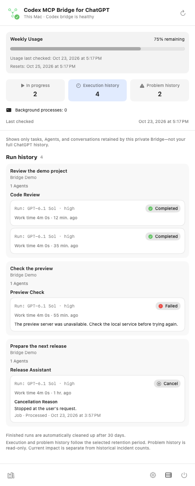
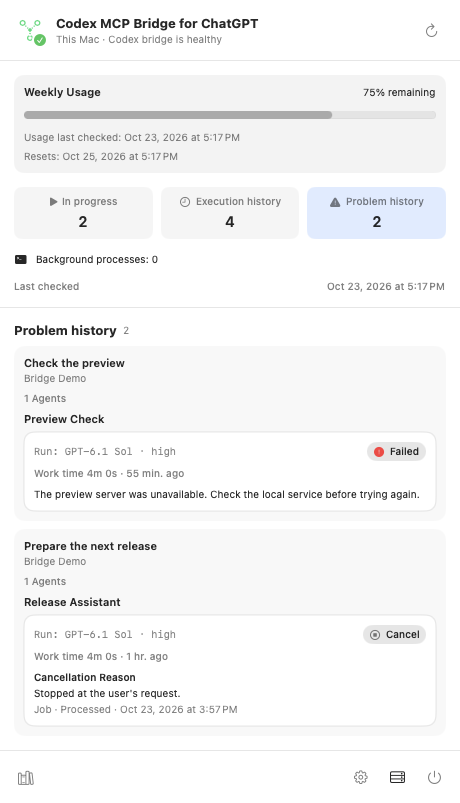
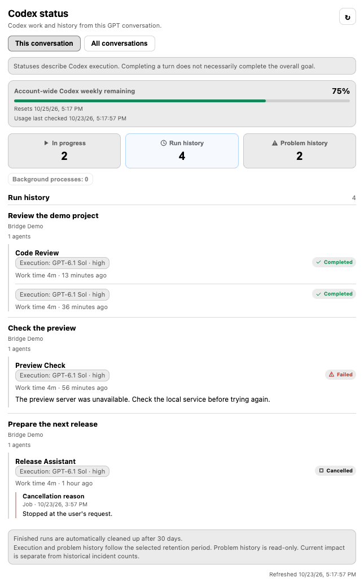
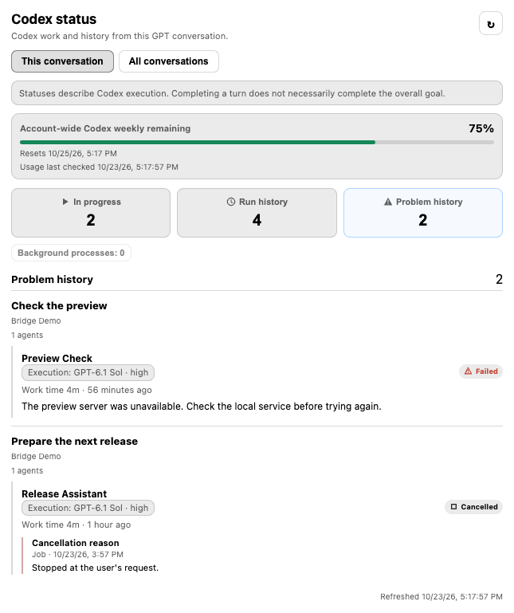

# Execution history and current work

The macOS menu uses **In progress**, **Execution history**, and **Problem history**.
The ChatGPT card labels execution history **Run history**. Input and approval
waits remain distinct states in In progress.
Execution history contains retained terminal Jobs. Problem history contains one
entry per retained failed, interrupted, or cancelled Job. Successful Jobs,
system incidents and extra recovery attempts do not add problem entries.
It is read-only, with no acknowledgement, recheck, retry-stop or resolution
workflow. Current service warnings follow current impact independently of
historical failures.

## Read the lists

Select a count to open its list, and select it again to collapse it. In ChatGPT,
choose **This conversation** or **All conversations** before inspecting the list.
Each list groups Activity → Agent → individual run. Every run keeps its own
status, model, reasoning level, speed selection and time. Recorded
errors or cancellation reasons appear once; missing reasons have no placeholder.
The lists omit private Job IDs and exact-detail controls. **Show more** appends
the next page without replacing entries already on screen.

  
  

  

  

Current rows sort by representative run start descending with stable identity ties.
An old Activity's new run moves to its new position. Activity grouping follows the
latest displayed run in the group. Progress/usage/observation changes do not reorder
runs or invalidate unrelated retained-history caches.

## Common saved retention policy

The actual stored choice is 7, 30, 90 days or numeric zero for unlimited retention.
The same policy governs run bodies, summaries, diagnostic events, problem/recovery
records and progression, retained question history, completion-delivery material and
persistent telemetry. N-day expiry uses a fixed Job end or first incident occurrence;
observation and metadata updates do not restart it. An absent installation record
and an explicit schema-2 legacy initialization default to 30. Invalid/missing current
policy fails without destructive cleanup, preserving numeric zero throughout.

Registry eviction frees bounded execution slots without deleting the durable
sanitized original. Large result bodies live in `job_result_bodies`; a response
preview or memory limit is not persistent deletion. Scoped exact reads can recover
a retained original after eviction/restart. Existing pre-policy missing originals
are marked legacy-partial and never described as restored. Missing old time evidence
has a fixed legacy estimate, never a newly stamped current time.

Logical expiry filters counts, pages, summaries and exact details before presentation.
Actual bounded cleanup removes associated bodies, summaries and diagnostics using a
fresh policy read in its write transaction. Unlimited policy prevents age deletion.
The existing scheduler rotates its bounded concerns; the events slice also requests
cleanup from the existing telemetry owner, which reads policy from state read-only.
No new cleanup daemon or operational writer is introduced.

Current execution, valid input/approval and cancellation identity are preserved.
Terminal delivery/uncertainty/hold does not reserve a separate permanent copy of
history. Minimal request/hash/outcome and exact dispatch/incident-attempt control
state prevents duplicate execution, automatic replay or a reset recovery budget;
those controls retain no historical original, reason or evidence. Expiry never
means delivered, approved, cancelled or recovered. A confirmed incident closure or
owner retirement ends the relevant retry control. Project archive ends live control
without removing retained recovery history; explicit project deletion has its
existing scoped management-ending semantics.

## Bounded summaries, pages and caches

Current clients request Job-based history with 12-item pages bound to scope,
history revision and the applied policy. Opening a list does not request exact
execution details. Older clients retain the Agent-based projection, including
up to three recent summaries per visible Agent. Pane switches
and unrelated progress refreshes reuse valid cache data. New history, expiry,
policy/security/project/scope changes and late responses use the same identity
checks. Cache eviction leaves the persistent original available.

Recovery records open at the first observed incident, before the first retry.
Repeated observation/retries keep that identity; confirmed recovery followed by an
actual recurrence creates a new one. Jobless history never borrows a newer Job or
project. Read-only problem summaries include recent progression and current impact;
the original retained steps remain in storage under the same policy. Automatic
maintenance retains its existing three-attempt authority, exact execution checks
and shutdown/admission priority. UI reads do not dispatch recovery actions.

## Verification boundary

Source and isolated synthetic fixtures verify policy, storage, query, cache and UI
contracts. They do not establish installed-app acceptance, actual GPT resumption,
or long-running stability. No operational app, database, settings or authentication
changes are part of this development work. See [the UI response contract](issue-251-display-contract.md).

## Process inspection

The dashboard ranks the entire known Agent set by last inspection attempt before
applying its 200-candidate display budget. It merges observations from all retained
cache entries. This replaces the repeated selection of the same 200 recent Agents
that left 84–88 of 284 Agents perpetually uninspected. Failed inspections also
participate in fair scheduling; active liveness can be checked again immediately.
Modern history rows only request non-loading background inspection, avoiding
unnecessary reads of old Codex threads. Live/unknown Agent state still receives
liveness inspection. Unknown results remain visibly unknown.

## Other macOS settings fixes

Notification authorization refreshes when settings open and when the application
becomes active. Authorized permission shows its current state; denied permission
links to macOS notification settings. Repeated requests do not prompt again after
authorization. The official model-description disclosure uses the shared full-row
button and leading-aligned, selectable text.

Current resource generations are recorded in the generated UI manifest. The
Dashboard and Settings have one current HTML file each. The Dashboard budget is
213 KiB across all nine supported languages. Retired Decision Card state remains
dormant and is not a run-history store.
